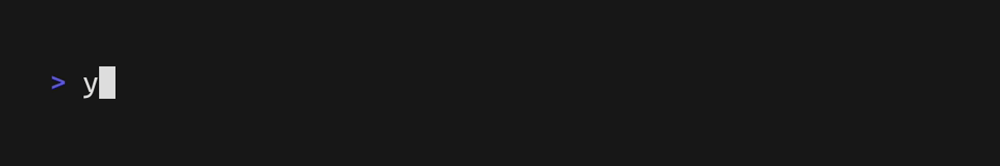
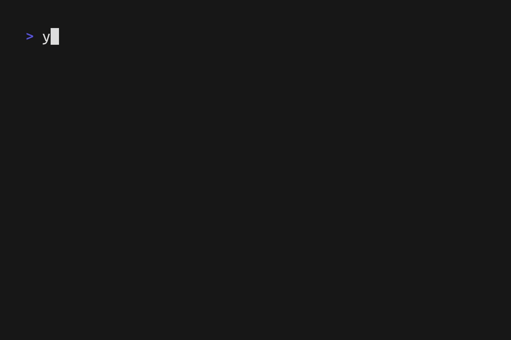

# yoel

yoel is a cli client for [Chula's Computer Engineering Grader](https://grader.nattee.net/) written in Go. It is one of my learning project alongside with [Falling sand simulation](https://github.com/Paaswn/sandfall-sim).

> [!IMPORTANT]
>
> ### LLM USAGE (v0.4.x and beyond)
>
> There is no usage of LLM outside of ~~writing test cases~~, and graderapi package. Additionally, every part of yoel's source code that is written by Codex has its name as a co-author

## Installation

### Windows

```pwsh
irm https://raw.githubusercontent.com/Paaswn/yoel/master/scripts/install.ps1 | iex
```

### macOS & Linux

```sh
curl -fsSL https://raw.githubusercontent.com/Paaswn/yoel/master/scripts/install.sh | sh
```

Downloads are checked against the release SHA-256 checksums. If installation
does not work, download the matching archive manually from the
[Yoel Releases page](https://github.com/Paaswn/yoel/releases). Releases are not
currently code-signed or macOS-notarized, so Windows SmartScreen or macOS
Gatekeeper may show a warning; do not disable platform security protections.

## Usage

### `yoel fetch`
 yoel fetch updates local problem registry to match the grader's. fetching notice will be shown if yoel couldn't find any problem metadata from local registry



### `yoel list`
show a list of every problem which can be seleceted interactively



### `yoel new <query> [<path>]`
```
create a problem locally. Any attachment is downloaded and extracted to CWD or provided path under its own directory, then open the problem's PDF automatically

flags: 
  [--force|-f] force creating a new problem
  [--no-pdf] disable opening pdf automatically behavior
  [--json|-j] format output as json
```


### `yoel submit <query>`
```
submit a problem to the grader. yoel automatically solves which source file to be sent, ( student.h > main.h > main.cpp > *.cpp  )

flags:
  [--with|w] <source_path> submit a problem to the grader with <source_path>, then overwrite its source path with this one
  [--dont-set] disable [--with|-w] overwriting source path behavior
  [--json] format output as json
```


> [!NOTE]
>
> a query could be a problem's id, or a problem's name. If yoel matches multiple problems from the name, an interactive list will be shown 

## Updating

Release builds can check and install the latest yoel release with:

```sh
yoel update
```
